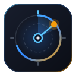
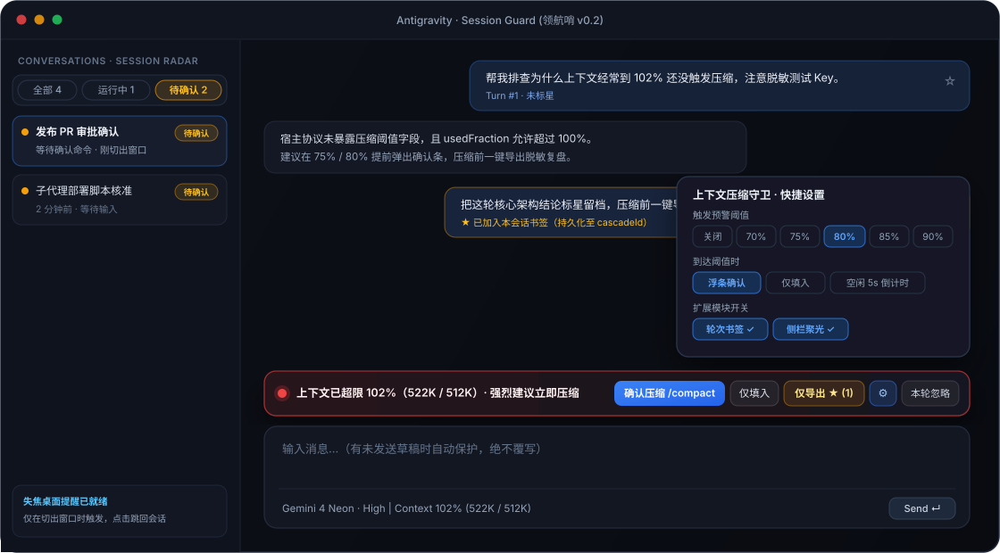
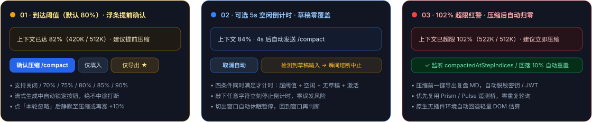

<div align="center">



# Antigravity Session Guard

**Catch context overflow before it hits 102%. Never leave a background subagent waiting unnoticed.**

Configurable Compaction Guard · Turn Bookmarks & Redacted Pre-Compact Markdown Export · Sidebar Attention Radar

[**English**](./README.en.md) · [**简体中文**](./README.md) · [**Changelog**](./CHANGELOG.md) · [**Architecture & Coexistence**](./docs/ARCHITECTURE.md) · [**Issues**](https://github.com/tone-leh/agy-session-guard/issues)

<p>
  
  
  
  
  
  <a href="./LICENSE"></a>
</p>

<picture>
  <source media="(prefers-color-scheme: dark)" srcset="assets/hero-dark.svg" />
  <source media="(prefers-color-scheme: light)" srcset="assets/hero-light.svg" />
  
</picture>

<sub>Adapts automatically to GitHub Dark &amp; Light themes · Run <code>npm run workbench</code> locally to drag context from 10% to 115% offline without touching your running Antigravity instance.</sub>

</div>

> **Non-Affiliation Disclaimer**  
> **Antigravity Session Guard is an independent MIT open-source project and is not affiliated with or endorsed by Google LLC.**  
> Zero `app.asar` patches, zero host restarts; “Antigravity” and “Google” are referenced solely for compatibility.

---

## Three Real Pain Points in Long Sessions

1. **Context silently climbs past `102%` without compacting**: The host telemetry exposes `estimatedTokensUsed / maxContextTokens`, with no user-configurable compaction threshold. A single long tool call pushes the window past 100% before you notice.
2. **Fear of losing key decisions before `/compact`**: Manually copying architecture conclusions from a 40-turn session is tedious, yet compacting without a clean snapshot feels risky.
3. **Background sessions waiting on approval while you work elsewhere**: With parallel conversations and subagents, an approval prompt can sit idle for 15 minutes until you switch back.

| Stay Under Budget · Compact Guard | Keep What Matters · Bookmarks & Export | Never Stall · Session Radar |
| :--- | :--- | :--- |
| Surfaces an unobtrusive confirmation bar at your chosen threshold (`70%–90%`), with optional 5-second idle cancelable countdown. | Star key turns (`☆ → ★`) per conversation; export redacted Markdown recaps in one click right before `/compact`. | Adds an opt-in `All / Running / Awaiting` filter pill in the sidebar plus out-of-focus OS notifications that jump straight back. |

---

## Core Modules

<p align="center">
  
</p>

| Module | Default | What It Does | Standalone UMD Core |
| :--- | :---: | :--- | :--- |
| **Compact Guard** | On (`80%` confirm) | Threshold alert bar (`off/70/75/80/85/90%`), confirm / insert-only / 5s idle countdown, quick `⚙` settings popover | [`packages/core/compact-guard.js`](./packages/core/compact-guard.js) |
| **Outline Bookmarks** | On | Per-`cascadeId` persisted `☆/★` turn stars + bookmarked-only filter inside Obsidian Prism's outline popover | [`packages/core/outline-bookmarks.js`](./packages/core/outline-bookmarks.js) |
| **Pre-Compact Export** | On | One-click `Export MD` / `Export ★ (N)` right on the compact bar with automatic redaction (`sk-`, `AIza`, `ghp_`, `Bearer`, JWT, PEM keys) | [`packages/core/precompact-export.js`](./packages/core/precompact-export.js) |
| **Session Radar** | Off (opt-in) | Sidebar `All / Running / Awaiting` attention filter pill + blurred-only desktop alerts (`Off / Awaiting / All`) | [`packages/core/session-radar.js`](./packages/core/session-radar.js) |

### Engineering Guardrails (Tested on Every Commit)

- **Triple Anti-Mis-Trigger Guard**: Never interrupts active streaming turns, never overwrites composer drafts (typing cancels countdown instantly), and suppresses dismissed alerts until `+10%` growth or automatic reset after compaction (`compactedAtStepIndices` or `-10%` drop).
- **Zero-ASAR & Zero Dependencies**: Pure Node.js `>= 22` + UMD scripts; never patches `app.asar` or restarts Antigravity.
- **0 `:has()`, 0fps Hibernation, 100% Lossless `destroy()`**: Inherits native and Obsidian Prism CSS variables, sleeps on `blur` / `document.hidden`, and cleans every DOM node, stylesheet, timer, and global on teardown.

---

## Quick Start (Node.js >= 22, Zero `npm install`)

### 1. Try the Offline Interactive Workbench First (Zero Impact on Live Antigravity)

```bash
git clone https://github.com/tone-leh/agy-session-guard.git
cd agy-session-guard

npm test         # 13 unit & hygiene tests (~130ms)
npm run workbench
# Open http://127.0.0.1:4179
```

### 2. Attach via Zero-ASAR CDP

```bash
# Preview matching host windows without injecting
node cli/cdp-attach.mjs --attach --dry-run

# Attach to an existing CDP-enabled Antigravity session
npm run attach

# Inspect live state or tear down 100% losslessly
npm run status
npm run remove
```

---

## Coexistence & Downstream Integration (MIT → GPL-3.0 Friendly)

- **Obsidian Prism & AG Pulse Ready**: Reuses `window.__agPrismMetricsBridge` and `window.agPulseHost` with zero duplicate polling; marks owned nodes `data-ag-no-i18n="1"` to stay isolated from Channel 4 DOM localization; yields automatically when a host suite sets `window.__agSessionGuardOwner`.
- See [`docs/ARCHITECTURE.md`](./docs/ARCHITECTURE.md) for the full coexistence and `vendor/` integration contract.

## License

[MIT](./LICENSE) — free to use, adapt, or vendor into downstream MIT or GPL-3.0 projects with attribution preserved.
