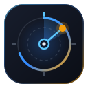
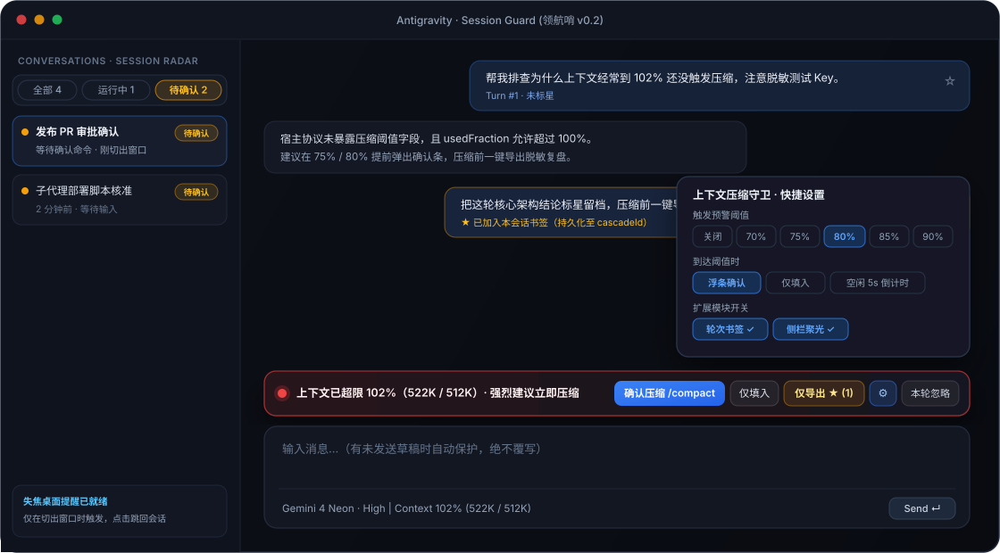

<div align="center">



# Antigravity Session Guard · 领航哨

**别等上下文飙到 102% 才想起压缩，别让子代理在后台干等二十分钟。**

自定义压缩阈值与提前确认 · 轮次星标与压缩前脱敏导出 · 侧栏待审批聚光与失焦提醒

[**简体中文**](./README.md) · [**English**](./README.en.md) · [**更新日志**](./CHANGELOG.md) · [**架构与共存契约**](./docs/ARCHITECTURE.md) · [**问题反馈**](https://github.com/tone-leh/agy-session-guard/issues)

<p>
  <a href="https://github.com/tone-leh/agy-session-guard/releases"></a>
  
  
  
  
  <a href="./LICENSE"></a>
</p>

<picture>
  <source media="(prefers-color-scheme: dark)" srcset="assets/hero-dark.svg" />
  <source media="(prefers-color-scheme: light)" srcset="assets/hero-light.svg" />
  
</picture>

<sub>自动跟随 GitHub 深浅模式渲染 · 本地执行 <code>npm run workbench</code> 即可打开离线交互舞台，拖动上下文滑块从 10% 实测到 115%（不触碰正在运行的 Antigravity）。</sub>

</div>

> **非官方开源声明 (Non-Affiliation Disclaimer)**  
> **Antigravity Session Guard is an independent MIT open-source project and is not affiliated with or endorsed by Google LLC.**  
> 本项目为独立社区开源工程，不修改任何官方安装包或 `app.asar`；文中出现的 “Antigravity” 与 “Google” 仅用于说明兼容对象。

---

## 写代码正上头时，最怕这三件事

长会话和多子代理协作里，有三个高频痛点宿主本身暂时没补齐：

1. **经常冲到 `102%` 还没压缩**：宿主协议只上报 `estimatedTokensUsed / maxContextTokens`，并没有可配置的压缩阈值字段；单轮大段工具输出一冲过去就爆窗，等想起来手敲 `/compact` 往往已经晚了。
2. **要压缩了，又怕关键结论被压丢**：前面几轮好不容易敲定的架构方案和排查根因，手动一条条复制太慢，不备份直接 `/compact` 又不踏实。
3. **后台会话卡在「等待确认」，人却切去看了别处**：开着三四个并行会话或子代理，其中一个早就在等审批，切回来才发现白白干等了十几分钟。

**领航哨（Session Guard）** 把这三件事串成一条顺手的闭环，装一次、全模块化按需开关：

| 不爆窗 · Compact Guard | 不丢档 · Bookmarks & Export | 不空等 · Session Radar |
| :--- | :--- | :--- |
| 到自定义阈值（如 `75%` / `80%`）就在输入框上方弹出确认条，一键 `/compact` 或开启空闲 5 秒可取消倒计时。 | 随手点亮每轮提问的 `☆ → ★` 书签；压缩前一键导出脱敏 Markdown 复盘，自动剔除密钥、Bearer 与 JWT。 | 侧栏顶部增加 `全部 / 运行中 / 待确认` 聚光条；切出窗口后，仅在需要审批或任务完成时发系统桌面通知。 |

---

## 功能图景与交互细节

### 1. 上下文压缩守卫（Compact Guard）

<p align="center">
  
</p>

- **阈值你说了算**：通过浮条右上角的 `⚙` 快捷浮窗随时切换 `关闭 / 70% / 75% / 80% / 85% / 90%`（API 支持任意 `50%–98%` 整数），无需翻找宿主设置页。
- **三种触发姿势**：
  - **浮条确认（默认）**：超过阈值时弹出克制的玻璃态浮条，点「确认压缩 `/compact`」或「仅填入」由你拍板；飙到 `>= 100%` 时切换猩红超限高亮。
  - **仅填入（最保守）**：只把 `/compact` 放进输入框，绝不替你按回车。
  - **空闲 5s 倒计时（可选进阶）**：只有当 **超过阈值 + 本轮非生成中 + 输入框完全为空 + 窗口处于激活态** 四个条件同时成立时才开始 5 秒倒计时；期间敲任意一个字或点「取消自动」，倒计时**瞬间熔断中止**。
- **压缩后自动复位**：监听宿主 `compactedAtStepIndices` 增长或占比回落 `>= 10%` 后自动清零忽略记录，下一轮照常护航。

### 2. 轮次书签 & 原生快捷跳转抽屉 & 压缩前脱敏导出（Outline Bookmarks + Pre-Compact Export）

- **单轮随手标星 + 原生 `★ N` 跳转抽屉（无需依赖皮肤也能用）**：在每轮用户消息气泡上挂载轻量 `☆ / ★` 按钮，按 `cascadeId` 本地持久化；一旦本会话有标星轮次，会话顶部右上角自动浮现紧凑的 **`★ N` 跳转胶囊**（0 书签时完全隐藏不占位），展开即可看到脱敏后的轮次摘要，点击平滑滚动定位并高亮闪烁目标气泡；若安装了 Obsidian Prism，还会自动联动其左侧提问大纲浮窗的 `★ N` 仅看书签筛选。
- **复制与 `↓ .md` 一键双出口**：一旦当前会话有标星轮次，压缩浮条上的导出按钮会自动切换为 **`仅导出 ★ (N)`**（一键复制到剪贴板），旁边紧邻 **`↓ .md`** 按钮（以及书签抽屉底部「下载 ★ .md」），直接把跨平台安全命名的 `.md` 复盘文件保存到本地，再点 `/compact` 一气呵成。
- **默认全量脱敏**：导出与抽屉摘要均自动清洗 `sk-` / `rk-` / `pk-` / `ak-` / `AIza` / `ghp_` / `Bearer Token` / `JWT` 及 `PEM PRIVATE KEY` 块，避免复盘笔记误带敏感凭据。

### 3. 多会话聚光雷达（Session Radar · 默认关闭，按需开启）

- 在侧边栏顶部插入紧凑的 `全部 / 运行中 / 待确认` 三段聚光胶囊，带实时数量徽章，有待审批会话时琥珀描边提醒，一键只看卡住的会话。
- **失焦桌面提醒**提供三档：`关闭（默认）` / `仅待确认` / `待确认与完成`。仅在窗口切出或隐藏时才发系统通知，你在当前窗口看着屏幕时绝不弹窗打扰；点击通知直接聚焦窗口并跳回对应会话。

---

## 模块总览与工程守则

| 模块 | 默认态 | 核心职责 | 独立源码（可单独引入） |
| :--- | :---: | :--- | :--- |
| **Compact Guard** | 开启（80% 浮条确认） | 上下文阈值预警、确认压缩、5s 空闲倒计时、一键 `↓ .md` 下载、快捷设置浮窗 | [`packages/core/compact-guard.js`](./packages/core/compact-guard.js) |
| **Outline Bookmarks** | 开启 | 单轮 `☆/★` 书签、原生 `★ N` 浮动跳转抽屉（无皮肤可用）、Prism 大纲筛选 | [`packages/core/outline-bookmarks.js`](./packages/core/outline-bookmarks.js) |
| **Pre-Compact Export** | 开启 | 压缩前一键复制或下载 `.md` 复盘文件、自动脱敏敏感凭据 | [`packages/core/precompact-export.js`](./packages/core/precompact-export.js) |
| **Session Radar** | 关闭（按需开启） | 侧栏 `全部/运行中/待确认` 聚光过滤条、失焦系统桌面通知 | [`packages/core/session-radar.js`](./packages/core/session-radar.js) |
| **Watch Daemon** | CLI 按需常驻 | Zero-ASAR 自适应退避守护进程，新窗口与 `Cmd+R` 重载自动补挂 | [`cli/watch-daemon.mjs`](./cli/watch-daemon.mjs) |

**五条硬红线（写进单测，每次提交必检）：**
1. **Zero-ASAR & 不重启宿主**：纯 CDP 动态附着已有本地调试端口，绝不改 `app.asar`、不强杀或重启客户端。
2. **三重防误触**：流式生成中禁止触发；输入框有任何草稿拒绝填入并秒停倒计时；忽略后静默至再涨 `+10%` 或完成压缩。
3. **零运行时依赖 & 5 语种内置**：纯原生 Node.js `>= 22` + UMD 前端脚本，内置简中 / 繁中 / 粤语 / English / 日本語，自动跟随界面语言。
4. **0 `:has()` & 0fps 后台休眠**：全套样式只读宿主 CSS 变量，窗口失焦或隐藏立刻暂停全部定时器。
5. **100% 无损退场**：`npm run remove` 或 `window.__agSessionGuard.destroy()` 彻底移除样式、Owned DOM、监听器和全局对象，恢复如初。

---

## 快速上手

环境要求：**Node.js >= 22**（零第三方 npm 依赖，无需 `npm install`）。

### 方式一：30 秒离线预览工作台（推荐先玩一遍，零碰本机 Antigravity）

```bash
git clone https://github.com/tone-leh/agy-session-guard.git
cd agy-session-guard

# 运行全套单元测试（17 项测试约 0.15s 完成）
npm test

# 启动离线交互工作台
npm run workbench
# 浏览器打开 http://127.0.0.1:4179
```

在离线工作台里你可以直接：
- 拖动上下文滑块从 `10%` 拉到 `102%`，看琥珀预警如何切为猩红超限；
- 在输入框里随便敲几个字，验证草稿保护如何拦住自动填入并秒停 5s 倒计时；
- 点亮右侧气泡的 `☆ → ★` 书签，展开顶部原生 `★ N` 跳转抽屉定位轮次，并一键复制或下载 `.md` 脱敏复盘；
- 切换 4 套皮肤配色（Obsidian Dark / Daylight Crystal / Warm Alabaster / Warm Dark）与 5 种界面语言。

### 方式二：Zero-ASAR 附着或后台守护运行中的 Antigravity

> 前提：Antigravity 已携带 `--remote-debugging-port=0` 启动（如果你已安装 Obsidian Prism，调试端口已经就绪；原生 macOS 用户也可通过 `open -a "/Applications/Antigravity.app" --args --remote-debugging-port=0` 启动）。

```bash
# 1. 先预演检查将命中的宿主窗口（只读，不注入）
node cli/cdp-attach.mjs --attach --dry-run

# 2. 单次附着挂载（可带初始参数 --threshold=75 --mode=confirm）
npm run attach

# 3. 或者启动轻量 Watch Daemon：自动发现端口、新开/重载窗口自动补挂（绝不重启宿主）
npm run watch
# 支持参数：node cli/watch-daemon.mjs --threshold=75 --mode=confirm --interval=3000 --max-backoff=30000

# 4. 查看实时运行状态与模块 debug 信息 / 100% 无损卸载还原
npm run status
npm run remove
```

---

## 与社区皮肤 / 遥测插件和平共存

**领航哨**按「独立好用、与皮肤共存、随时可被整模块或单模块吸收」的标准设计：

| 搭配对象 | 协作机制 |
| :--- | :--- |
| **[Obsidian Prism](https://github.com/RMvdesi/obsidian-prism)** | 零重复轮询直接复用 `window.__agPrismMetricsBridge`；四套深浅色 CSS 变量原生融入；所有 Owned DOM 标注 `data-ag-no-i18n="1"` 避免被 Channel 4 误译；左侧大纲自动挂载书签筛选；若未来被 Prism 整合，只要设置 `window.__agSessionGuardOwner = 'obsidian-prism'`，独立版即自动礼让退出。 |
| **[AG Pulse (`antigrative-dashboard`)](https://github.com/ATtacK030130/antigrative-dashboard)** | 自动读取 `window.agPulseHost` 或状态条 Shadow DOM 上下文百分比，不抢占不冲突。 |
| **原生无插件 Antigravity** | 自动回退轻量 DOM 估算与宿主原生 CSS 变量，开箱即用。 |

<details>
<summary><strong>CLI 参数速查、目录结构与下游集成示例（点击展开）</strong></summary>

#### CLI 选项
```bash
node cli/cdp-attach.mjs --attach --threshold=75 --mode=confirm         # 自定义 75% 浮条确认
node cli/cdp-attach.mjs --attach --threshold=80 --mode=auto-countdown  # 80% 空闲 5s 倒计时
node cli/cdp-attach.mjs --attach --port=9222                           # 手动指定 CDP 端口
node cli/watch-daemon.mjs --threshold=75 --interval=3000               # 常驻守护：新开/重载窗口自动附着
node cli/watch-daemon.mjs --once --json                                # 单次核对并输出 JSON（便于脚本/计划任务）
node cli/cdp-attach.mjs --remove                                       # 100% 无损卸载
```

#### 仓库结构
```text
agy-session-guard/
├── assets/                   # 品牌 Logo 与深浅双主题矢量演示图
├── packages/core/            # 零依赖 UMD 核心模块（可直接被下游 vendor/ 引入）
│   ├── compact-guard.js      #   G: 上下文压缩阈值、确认浮条、5s 倒计时、快捷浮窗
│   ├── outline-bookmarks.js  #   D: 轮次星标书签与左侧大纲书签过滤
│   ├── precompact-export.js  #   D: 压缩前结构化 Markdown 导出与凭据脱敏
│   ├── session-radar.js      #   B: 侧栏状态聚光条与失焦系统通知
│   ├── context-source.js     #   上下文数据源桥接（Prism/Pulse 优先，DOM 回退）
│   ├── coexist.js            #   Owner 礼让协议、配置校验与 0fps 休眠
│   ├── styles.js             #   纯宿主 CSS 变量自适应样式（0 :has()）
│   ├── i18n.js               #   5 语种内置词表
│   └── index.js              #   统一挂载入口 mountSessionGuard()
├── cli/                      # Zero-ASAR 纯 CDP 挂载器与零-eval 打包器
├── workbench/                # 离线交互预览工作台（localhost:4179）
├── docs/                     # 架构与共存契约文档 + GitHub Actions CI 模板
└── test/                     # Node 22 原生测试套件（node --test）
```

#### 下游主题套件按需集成示例（MIT 向上兼容 GPL-3.0）
```js
// 标记由宿主套件接管（独立 CDP 注入将自动礼让）
window.__agSessionGuardOwner = 'obsidian-prism';

const guard = window.__agSgCore.mountSessionGuard({
  win: window,
  doc: document,
  source: 'obsidian-prism',
  persistConfig: false, // 交给宿主设置中心持久化
  config: {
    compactThreshold: 80,
    compactTriggerMode: 'confirm',
    modules: { compactGuard: true, precompactExport: true, outlineBookmarks: true, sessionRadar: false },
  },
});
```

</details>

---

## 当前验证范围

| 项目 | 验证方式 | 当前状态 |
| :--- | :--- | :--- |
| 核心状态机、三重防误触、Watch Daemon、原生书签跳转与 `.md` 下载 | Node.js 22 `node --test`（17 项单测） | 全部通过 |
| 四套主题变量适配、5 语种切换、无损 `destroy()` | 离线交互工作台（`workbench/server.mjs`）+ 单元冒烟 | 已验证 |
| Zero-ASAR CDP 附着与目标白名单 | 参数校验与目标过滤单测 + `--dry-run` 路径 | 已验证（跨平台真机实测持续补充中） |

---

## 开源许可

本项目基于 **[MIT License](./LICENSE)** 开源，可自由使用、修改或整合进其他开源项目（包括 `GPL-3.0` 项目，保留版权声明即可）。欢迎提交 Issue 与 Pull Request 一起把 Antigravity 的长会话体验打磨得更顺手。
