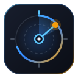
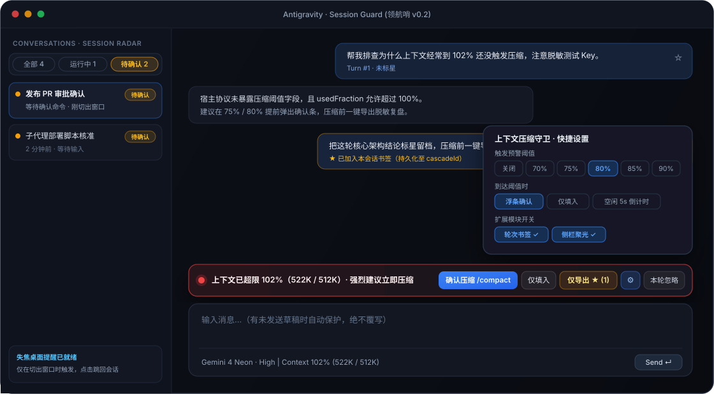
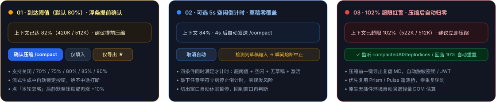

<div align="center">



# Antigravity Session Guard · 领航哨

**别等上下文飙到 102% 才想起压缩，让长会话保持静默、清爽、无损续接。**

默认 3s 静默无弹窗自动压缩 + 滚屏盾 · `/clear` 同项目无痕重启 · 草稿保险箱与交接提示 · 原生 Watch Sidecar

[**English**](./README.md) · [**简体中文**](./README.zh-CN.md) · [**更新日志**](./CHANGELOG.md) · [**架构与共存契约**](./docs/ARCHITECTURE.md) · [**问题反馈**](https://github.com/tone-leh/agy-session-guard/issues)

<p>
  <a href="https://github.com/tone-leh/agy-session-guard/releases"></a>
  <a href="https://github.com/tone-leh/agy-session-guard/actions/workflows/ci.yml"></a>
  
  
  
  
  <a href="./LICENSE"></a>
</p>

<picture>
  <source media="(prefers-color-scheme: dark)" srcset="assets/hero-dark.svg" />
  <source media="(prefers-color-scheme: light)" srcset="assets/hero-light.svg" />
  
</picture>

<sub>自动跟随 GitHub 深浅模式渲染 · 本地执行 <code>npm run workbench</code> 即可打开离线交互舞台，拖动上下文滑块从 10% 实测到 115%（不触碰正在运行的 Antigravity）。</sub>

</div>

> **非官方开源声明 (Non-Affiliation Disclaimer)**  
> **Antigravity Session Guard is an independent MIT open-source project and is not affiliated with or endorsed by Google LLC.**  
> 本项目为独立社区开源工程，不修改任何官方安装包或 `app.asar`；文中出现的 “Antigravity” 与 “Google” 仅用于说明兼容对象。

> **生态定位说明**  
> 本项目是基于 **Zero-ASAR Electron CDP** 的 Antigravity 会话护航与侧栏聚光插件（深度兼容 Obsidian Prism）。如果你更偏好 **零 CDP 注入、100% 原生 MCP App 侧边栏** 的模块化方案，也可以搭配或选用同系列 Antigravity 2.0 原生套件：[agy-xray](https://github.com/tone-leh/agy-xray)（上下文透视与时光机）、[agy-guard](https://github.com/tone-leh/agy-guard)（本地安全围栏与快照）、[agy-mem](https://github.com/tone-leh/agy-mem)（代码锚定记忆图谱）、[agy-canvas](https://github.com/tone-leh/agy-canvas)（视觉批注画布）、[agy-remote](https://github.com/tone-leh/agy-remote)（手机与 IM 远程遥控）、[agy-review](https://github.com/tone-leh/agy-review)（PR 级源码 Diff 批注台）。

---

## 写代码正上头时，最怕这三件事

长会话和多子代理协作里，有三个高频痛点宿主本身暂时没补齐：

1. **经常冲到 `102%` 还没压缩**：宿主协议只上报 `estimatedTokensUsed / maxContextTokens`，缺少用户可配的压缩阈值；单轮大段工具输出一冲过去就爆窗，等想起来手敲 `/compact` 往往已经晚了。
2. **压缩或重开对话时担心丢关键结论与草稿**：几十轮敲定的架构方案和排查根因手动整理太慢，切会话或重载还可能把没发出去的长草稿弄丢。
3. **后台会话卡死或等待审批，人却切去了别处**：并行跑多会话或子代理时，流式输出静默卡死或等待确认往往要切回来才发现。

**领航哨（Session Guard）** 把这三件事串成一条顺手的闭环，装一次、全模块化按需开关：

| 不爆窗 · 静默压缩守卫 | 无痕重启 · 草稿与无损交接 | 不空等 · 停滞看门狗与聚光雷达 |
| :--- | :--- | :--- |
| 默认开启 **`auto-silent`（80% 阈值，空闲 3s 静默无弹窗自动压缩）**，内置视口滚屏盾稳住阅读位置；也可随时切换为浮条确认、仅填入或 3s 可取消倒计时。 | 支持 `/clear` 与 `/clear keep` 同项目无痕开新对话（清零图片与长日志）；草稿保险箱防丢字，压缩前一键脱敏复制或下载 `.md` 复盘。 | 实时估算上下文燃尽轮次、标记 `>= 18%` 单轮突增、监测流式卡死（支持 `+5m` 延后）；按需开启侧栏 `全部 / 运行中 / 待确认` 聚光条与失焦桌面通知。 |

---

## 功能图景与核心细节（`v0.4.0`）

### 1. 上下文压缩守卫（Compact Guard）

<p align="center">
  
</p>

- **默认静默无打扰（`auto-silent`，80% / 3s 空闲）**：达到阈值、当前非流式生成、输入框完全为空且用户未在滚动页面时，静默等待 3 秒后通过 Lexical v2.35 两步斜杠选择自动触发 `/compact`，全程零弹窗；触发期间启用**非侵入视口滚屏盾（Viewport Scroll Shield）与滚屏静置保护**，阻止宿主跳回底部，并尊重用户主动滚轮操作。
- **四种触发姿势自由切换**：
  - **`auto-silent`（默认）**：零弹窗空闲 3s 静默自动压缩；打字或滚动立刻静默中止。
  - **`confirm`（浮条确认）**：流式生成中自动隐藏，空闲时浮现精简磨砂玻璃确认条（最多 2 个核心操作按钮）；飙到 `>= 100%` 切换猩红超限提醒。
  - **`fill-only`（仅填入）**：只把 `/compact` 放进输入框，绝不自动发送。
  - **`auto-countdown`（空闲 3s 可取消倒计时）**：可见倒计时浮条，敲任意字符或点击取消即刻熔断。
- **智能压缩焦点预设（`/compact <focus>`）**：可在快捷设置切换 **默认 / 代码与报错 / ★ 书签决策 / 自定义提示**，自动脱敏拼接精准保留指令。
- **压缩后无损续接卡 + 自动复位**：压缩前静默留存脱敏锚点；监测到宿主完成压缩（按 `cascadeId` 隔离遥测快照）后自动复位并浮现 1 行翠绿「填入续接提示 / 复制锚点」小条（零覆盖草稿）。

### 2. 同项目无痕重启（Clean Slate）与草稿保险箱（Draft Vault）

- **`/clear` 与 `/clear keep`**：在当前项目内一键开启全新干净会话，甩掉累积的截图附件与长工具日志；输入 `/clear keep` 时自动提取一段精简脱敏的交接摘要带入新对话。
- **草稿保险箱（Draft Guard）**：按 `cascadeId` 防抖自动保存未发送草稿（保留 7 天），切会话或 `Cmd+R` 重载后回到空输入框即给出 1 行脱敏恢复条，发送后自动清理。
- **一键开新会话交接（New-Session Handoff）**：将当前目标、标星结论与最新进展整理为脱敏结构化提示词，一键复制到剪贴板。

### 3. 原生操作栏轮次书签（按需开启 · Opt-in）与跨会话档案库

- **默认关闭、零视觉打扰**：可在设置页按需打开「轮次书签」。开启后以 16px 矢量图标紧贴用户消息原生 Copy / Undo 操作栏呈现（配悬浮提示），不挤占对话气泡内部。
- **原生 `★ N` 跳转抽屉 & 跨会话档案库（`Ctrl/Cmd + Shift + B`）**：有标星轮次时右上角浮现紧凑 `★ N` 跳转胶囊，平滑滚回目标轮次并脉冲高亮；支持跨会话检索、脱敏复制与一键 `↓ .md` 本地下载，自动清洗 `sk-` / `rk-` / `pk-` / `ak-` / `AIza` / `ghp_` / `Bearer` / `JWT` / `PEM PRIVATE KEY`。

### 4. 回合看门狗（Watchdog）与多会话聚光雷达（Session Radar）

- **Session Watchdog（默认开启，3m 卡死阈值）**：追踪每轮 Token 增量估算剩余轮次、标记 `>= 18%` 单轮突增；流式生成静默卡死时弹出告警，支持 **`+5m` 延后（Snooze）**。
- **Session Radar（默认关闭，按需开启）**：适配 Antigravity v2.35.1 侧栏 DOM，提供 `全部 / 运行中 / 待确认` 三段聚光条及三档失焦桌面提醒（`关闭 / 仅待确认 / 待确认与完成`），窗口处于前台时绝不打扰。

---

## 模块总览与工程守则

| 模块 | 默认态 | 核心职责 | 独立源码（可单独引入） |
| :--- | :---: | :--- | :--- |
| **Compact Guard** | 开启（80% `auto-silent`，3s） | 静默无弹窗空闲压缩、滚屏盾、智能 `/compact <focus>` 预设、Lexical v2.35 两步选择、压缩后续接卡 | [`packages/core/compact-guard.js`](./packages/core/compact-guard.js) |
| **Clean Slate** | 开启 | `/clear` 与 `/clear keep` 同项目无痕新对话重启（清零图片与长日志） | [`packages/core/clean-slate.js`](./packages/core/clean-slate.js) |
| **Draft Guard** | 开启 | 按 `cascadeId` 防抖暂存未发送草稿（7 天 TTL），防切会话 / `Cmd+R` 丢字 | [`packages/core/draft-guard.js`](./packages/core/draft-guard.js) |
| **Pre-Compact Export & Handoff** | 开启 | 压缩前一键复制/下载 `.md` 脱敏复盘、压缩后锚点回填、开新会话 Handoff 提示词 | [`packages/core/precompact-export.js`](./packages/core/precompact-export.js) · [`recovery-handoff.js`](./packages/core/recovery-handoff.js) |
| **Session Watchdog** | 开启（3m 卡死阈值） | 燃尽速率估算（约剩 N 轮）、单轮 `>= 18%` 突增标记、流式卡死监测与 `+5m` Snooze | [`packages/core/session-watchdog.js`](./packages/core/session-watchdog.js) |
| **Prism Unified Bridge & Status Card** | 自动检测 | 与 Obsidian Prism 同装时原生内嵌进 Prism 上下文卡片（零额外底部胶囊）并接入「模块」设置页；无 Prism 时渲染极简 `%` 胶囊、精简快捷卡（≤7 控件）与 3 行原生设置 | [`packages/core/prism-bridge.js`](./packages/core/prism-bridge.js) · [`status-pill.js`](./packages/core/status-pill.js) |
| **Outline Bookmarks & Vault** | 关闭（按需开启） | 原生 Copy/Undo 操作栏 16px SVG 书签、浮动 `★ N` 跳转抽屉、跨会话书签档案库（`Ctrl/Cmd+Shift+B`） | [`packages/core/outline-bookmarks.js`](./packages/core/outline-bookmarks.js) · [`bookmark-vault.js`](./packages/core/bookmark-vault.js) |
| **Session Radar** | 关闭（按需开启） | 侧栏 `全部/运行中/待确认` 聚光过滤条、失焦系统桌面通知 | [`packages/core/session-radar.js`](./packages/core/session-radar.js) |
| **Native Plugin, Watch Sidecar & Doctor** | 插件 / CLI | 原生 `plugin.json` + watch sidecar（`npm run install:plugin`）、`npm run watch` 自适应守护与只读 `npm run doctor` | [`plugin.json`](./plugin.json) · [`cli/install-plugin.mjs`](./cli/install-plugin.mjs) · [`cli/doctor.mjs`](./cli/doctor.mjs) |

**五条硬红线（写进单测，CI 每次提交必检）：**
1. **Zero-ASAR & 不重启宿主**：纯 CDP 动态附着已有本地调试端口，绝不改 `app.asar`、不强杀或重启客户端。
2. **防误触 + 滚屏盾**：流式生成中不触发；输入框有草稿即刻中止；滚动浏览时延后并锁定阅读位置；压缩完成后自动复位。
3. **零运行时依赖 & 8+1 语种完整覆盖**：纯原生 Node.js `>= 22` + UMD 前端脚本，内置简中 / 繁中 / 粤语 / English / 日本語 / 한국어 / Español / Français / Deutsch，自动跟随界面语言，原生适配 Split View 多分屏焦点窗格。
4. **0 `:has()` & 0fps 后台休眠**：样式只读宿主 CSS 变量，窗口失焦或隐藏立刻暂停全部定时器。
5. **100% 无损退场**：`npm run remove` 或 `window.__agSessionGuard.destroy()` 彻底移除样式、Owned DOM、监听器和全局对象。

---

## 快速上手

环境要求：**Node.js >= 22**（零第三方 npm 依赖，无需 `npm install`）。

### 方式一：30 秒离线预览工作台（零触碰本机 Antigravity）

```bash
git clone https://github.com/tone-leh/agy-session-guard.git
cd agy-session-guard

# 运行全套单元测试（46 项测试：无同级 Prism 开发仓时 45 通过 / 1 条件跳过 / 0 失败）
npm test

# 启动离线交互工作台
npm run workbench
# 浏览器打开 http://127.0.0.1:4179
```

在离线工作台里你可以直接：
- 拖动上下文滑块从 `10%` 拉到 `102%`，体验静默自动压缩、确认条与猩红超限；
- 在输入框敲字验证草稿保护与 `/clear` 行为；
- 体验书签跳转抽屉、跨会话档案库、脱敏 `.md` 复盘下载及 4 套主题配色切换。

### 方式二：安装原生插件 Sidecar 或通过 Zero-ASAR CLI 运行

> 前提：Antigravity 已携带 `--remote-debugging-port=0` 启动（若已安装 Obsidian Prism，调试端口已就绪；macOS 原生用户也可通过 `open -a "/Applications/Antigravity.app" --args --remote-debugging-port=0` 启动）。

```bash
# 方案 A：一键安装为 Antigravity 原生插件（写入 ~/.gemini/config/plugins/agy-session-guard，含 watch sidecar）
npm run install:plugin

# 方案 B：直接通过仓库 CLI 只读体检 / 单次附着 / 常驻守护
npm run doctor
node cli/cdp-attach.mjs --attach --dry-run
npm run attach
npm run watch

# 查看实时运行状态 / 100% 无损卸载还原
npm run status
npm run remove
```

---

## 与 Obsidian Prism 及社区插件和平共存

如果你在使用 **[Obsidian Prism](https://github.com/RMvdesi/obsidian-prism)** 的视觉主题套件，两者可以无缝叠用；如果你只需要纯粹的压缩守卫、`/clear` 无痕重启、草稿保险箱与卡死监测，**领航哨（Session Guard）** 也可以零主题入侵独立运行：

| 搭配对象 | 协作机制 |
| :--- | :--- |
| **[Obsidian Prism](https://github.com/RMvdesi/obsidian-prism)** | 零重复轮询直接复用 `window.__agPrismMetricsBridge`；**自动内嵌进 Prism 上下文卡片 Shadow DOM（零额外底部胶囊）**，并把带白话说明的模块设置接入 Prism 设置页「模块」标签，双向实时同步配置与 8+1 语种；所有 Owned DOM 标注全套 i18n 跳过属性；若未来被宿主吸收，设置 `window.__agSessionGuardOwner` 即自动礼让退出（详见 [`docs/PRISM_CHANNEL_INTEGRATION.md`](./docs/PRISM_CHANNEL_INTEGRATION.md)）。 |
| **[AG Pulse (`antigrative-dashboard`)](https://github.com/ATtacK030130/antigrative-dashboard)** | 自动读取 `window.agPulseHost` 或状态条 Shadow DOM 上下文百分比，互不抢占。 |
| **原生无插件 Antigravity** | 自动回退轻量 DOM 估算与宿主原生 CSS 变量，呈现克制的底部 `%` 状态胶囊、精简快捷卡片与原生 Settings 设置区。 |

<details>
<summary><strong>CLI 参数速查、目录结构与下游集成示例（点击展开）</strong></summary>

#### CLI 选项
```bash
node cli/cdp-attach.mjs --attach --threshold=80 --mode=auto-silent     # 默认：80% 空闲 3s 静默无弹窗压缩
node cli/cdp-attach.mjs --attach --threshold=75 --mode=confirm         # 自定义 75% 浮条确认
node cli/cdp-attach.mjs --attach --threshold=80 --mode=auto-countdown  # 80% 空闲 3s 可取消倒计时
node cli/cdp-attach.mjs --attach --port=9222                           # 手动指定 CDP 端口
node cli/watch-daemon.mjs --threshold=80 --interval=3000               # 常驻守护：新开/重载窗口自动附着
node cli/watch-daemon.mjs --once --json                                # 单次核对并输出 JSON
node cli/install-plugin.mjs --dry-run                                  # 预演原生插件安装清单
node cli/cdp-attach.mjs --remove                                       # 100% 无损卸载
```

#### 仓库结构
```text
agy-session-guard/
├── plugin.json                # Antigravity 原生插件清单
├── sidecars/daemon/           # 原生托管 Zero-ASAR watch sidecar
├── assets/                    # 品牌 Logo 与深浅双主题矢量演示图
├── packages/core/             # 零依赖 UMD 核心模块（可直接被下游 vendor/ 引入）
│   ├── compact-guard.js       #   上下文压缩阈值、auto-silent 静默压缩、滚屏盾、确认浮条
│   ├── clean-slate.js         #   /clear 与 /clear keep 同项目无痕重启
│   ├── draft-guard.js         #   未发送草稿保险箱（按 cascadeId，7 天 TTL）
│   ├── precompact-export.js   #   压缩前结构化 Markdown 导出与凭据脱敏
│   ├── recovery-handoff.js    #   压缩后无损续接卡与开新会话 Handoff 提示词
│   ├── session-watchdog.js    #   上下文燃尽估算、突增标记与流式卡死 +5m 延后
│   ├── outline-bookmarks.js   #   操作栏 16px SVG 书签（opt-in）与原生跳转抽屉
│   ├── bookmark-vault.js      #   跨会话书签档案库（Ctrl/Cmd + Shift + B）
│   ├── session-radar.js       #   侧栏状态聚光条与失焦系统通知（opt-in）
│   ├── prism-bridge.js        #   Obsidian Prism 统一设置桥接与双向同步
│   ├── status-pill.js         #   Prism 卡片原生内嵌 / 独立模式极简胶囊与快捷卡
│   ├── context-source.js      #   上下文数据源桥接与 Split View 多分屏追踪
│   ├── coexist.js             #   Owner 礼让协议、配置校验与 0fps 休眠
│   ├── styles.js              #   纯宿主 CSS 变量自适应样式（0 :has()）
│   ├── i18n.js                #   8+1 语种完整词表
│   └── index.js               #   统一挂载入口 mountSessionGuard()
├── cli/                       # Zero-ASAR CDP 挂载器、watch daemon、doctor、install-plugin
├── workbench/                 # 离线交互预览工作台（localhost:4179）
├── docs/                      # 架构文档、Prism Channel 13 蓝图与 CI 示例
└── test/                      # Node 22 原生测试套件（46 项测试）
```

#### 下游主题套件按需集成示例（MIT 向上兼容 GPL-3.0）
```js
// 标记由宿主套件接管（独立 CDP 注入将自动礼让）
window.__agSessionGuardOwner = 'obsidian-prism';

const guard = window.__agSgCore.mountSessionGuard({
  win: window,
  doc: document,
  source: 'obsidian-prism',
  persistConfig: false, // 交给宿主设置中心持久化
  config: {
    compactThreshold: 80,
    compactTriggerMode: 'auto-silent',
    modules: {
      compactGuard: true,
      precompactExport: true,
      draftGuard: true,
      sessionWatchdog: true,
      outlineBookmarks: false,
      sessionRadar: false,
    },
  },
});
```

</details>

---

## 当前验证范围

| 项目 | 验证方式 | 当前状态 |
| :--- | :--- | :--- |
| 核心状态机（静默压缩、滚屏盾、`/clear`、草稿箱、续接交接、书签、看门狗、多分屏、8+1 语种、Watch Daemon、Doctor 与插件安装器） | Node.js 22+ `node --test`（46 项单测：45 通过、1 项同级 Prism 仓条件跳过、0 失败） | 全部通过（CI 覆盖 Ubuntu / macOS / Windows） |
| 主题变量适配、状态流转与无损 `destroy()` | 离线工作台 `node workbench/server.mjs --smoke` | CI 持续验证 |
| Zero-ASAR CDP 附着与目标白名单 | 单元校验 + `--dry-run` 路径 | 已验证 |

---

## 生态搭配

由 [@tone-leh](https://github.com/tone-leh) 持续维护的 Google Antigravity 开源效率插件系列：

| 插件 | 定位 | 架构方式 |
| :--- | :--- | :--- |
| **[Agy X-Ray（透视镜）](https://github.com/tone-leh/agy-xray)** | 上下文构成透视、实时工作区文件树（`toggle-aux-pane`）与中英双语跨会话时光机 | 100% 原生 MCP App（`SEP-1865`）+ Lifecycle Hooks（零补丁） |
| **Antigravity Session Guard（领航哨）** *(本仓库)* | 静默自动压缩、`/clear` 同项目无痕重启、草稿保险箱、交接提示与停滞看门狗 | Zero-ASAR 原生插件 + watch sidecar（零运行时依赖） |

两款插件天然互补：**Agy X-Ray** 帮你看清上下文为什么膨胀、改了哪些文件以及历史方案在哪，**Session Guard** 负责在日常长会话里自动守住阈值、防卡死与无损重启。同系列更多聚焦日常刚需的 Antigravity 原生插件正在持续打磨中，欢迎关注 [@tone-leh](https://github.com/tone-leh) 获取后续更新。

---

## 开源许可

本项目基于 **[MIT License](./LICENSE)** 开源，可自由使用、修改或整合进其他开源项目（包括 `GPL-3.0` 项目，保留版权声明即可）。欢迎提交 Issue 与 Pull Request 一起把 Antigravity 的长会话体验打磨得更顺手。
